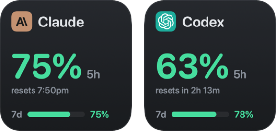

<p align="center">
  
</p>

<h1 align="center">NabBar</h1>

<p align="center">
  Your Codex, Claude and Command Code limits in the macOS menu bar,<br>
  on a Touch Portal deck, and on your iPhone's Home Screen.
</p>

<p align="center">
  <a href="https://github.com/M-Nabeegh/NabBar/releases/latest/download/NabBar.dmg"><b>Download NabBar for Mac (.dmg)</b></a>
  &nbsp;·&nbsp;
  <a href="https://github.com/M-Nabeegh/NabBar/releases/latest">All releases</a>
  &nbsp;·&nbsp;
  <a href="https://github.com/M-Nabeegh/NabBar/actions/workflows/ci.yml"></a>
</p>

<p align="center">
  
</p>

---

## What you get

- **Menu bar.** The percent left for each tool, coloured green above 50%, yellow from 20 to 50%,
  red under 20%. Click it for each tool's 5-hour and weekly limits and when they reset.
- **Touch Portal.** A ready-made button face for each tool: logo, the 5-hour number in its colour,
  the reset time and a weekly bar.

  

- **iPhone.** A Home Screen widget, through the [Notify!](https://getnotifyapp.com) app, with Claude
  and Codex side by side: `Claude 5h · 7d  44 · 80%`.
- **Working / done dots.** A blue dot on the Claude or Codex logo in the menu bar while it works on
  a task, a green one when it finishes. Opening the menu clears the green dot. NabBar reads this from
  the tools' own session logs and changes nothing in them.
- **Alerts.** A macOS notification when a limit drops into yellow, red or runs out.

It checks every 5 minutes, or when you click Refresh. Claude takes about 3 seconds.

## Install

1. [Download `NabBar.dmg`](https://github.com/M-Nabeegh/NabBar/releases/latest/download/NabBar.dmg),
   open it, and drag **NabBar** onto **Applications**.
2. Open NabBar. macOS says it can't verify the developer, because NabBar isn't notarized by Apple.
   Click **Done**, then go to **System Settings → Privacy & Security**, scroll down to
   "NabBar was blocked", and click **Open Anyway**. You only do this once.
3. NabBar appears in the menu bar. It has no Dock icon.

Needs macOS 15 or later on Apple silicon.

Or with Homebrew: `brew tap m-nabeegh/tap`, then `brew install --cask nabbar` (newer Homebrew asks you
to run `brew trust m-nabeegh/tap` first). Step 2 above still applies.

## Set up each tool

NabBar reads usage from the tools you already use. It never logs in for you and never changes their
logins.

| Tool | What NabBar needs |
|---|---|
| **Claude** | The `claude` CLI, logged in and past its first-run screens: run `claude auth login`, then `claude` once and pick a theme. |
| **Codex** | The Codex CLI. If you only have the copy inside the ChatGPT app, open NabBar → Settings → Providers → Codex, click **Choose…**, and pick `/Applications/ChatGPT.app/Contents/Resources/codex-cli/CodexCLI.app/Contents/MacOS/codex`. Then click **Refresh** once. |
| **Command Code** | Be logged in to Command Code. |

## Touch Portal

Download `NabBar-TouchPortal.tpp` from the
[latest release](https://github.com/M-Nabeegh/NabBar/releases/latest) and import it in
Touch Portal → Settings → Plug-ins.

For a button like the ones above: add **Change icon from plugin state**, pick
**NabBar: Claude tile** (or Codex), and leave the button text empty. Add the action
**NabBar → Refresh NabBar now** to a button to refresh from the deck.

Every value the plugin publishes, per tool (`codex`, `claude`, `commandcode`), under
`com.nabeegh.nabbar.touchportal.state.<tool>.`:

| State | Example |
|---|---|
| `tile` | the finished button face shown above |
| `left`, `used`, `reset` | `44%`, `56%`, `Resets in 34m` (5-hour window) |
| `weekLeft`, `weekReset` | `80%`, `Resets Oct 5 at 9pm` |
| `summary` | `Claude` / `5h 44% · 7d 80%` |
| `level`, `weekLevel` | `green`, `yellow`, `red` or `depleted`, with matching events for button colours |
| `icon` | two plain bars, 5-hour and weekly, for buttons that show their own text |

The plugin reads `~/.nabbar/status.json` and the tile images next to it, and talks only to Touch
Portal on your Mac.

## iPhone widget

1. Install [Notify!](https://getnotifyapp.com) on the iPhone and turn on Settings → Home Screen
   Widgets in it.
2. Copy your device link from Notify!.
3. In NabBar → Settings → Notify!, paste the link, press **Save Link**, then turn on
   **Publish to Notify!**. Leave only **Home Screen widget** on if you don't want a Live Activity.
4. Add the Notify! widget from the iOS widget picker (medium size fits both tools). iOS redraws it
   about every 15 minutes.

## What NabBar reads and sends

Reads, never writes:

- **Claude:** the output of `claude /usage`; `~/.claude.json` for your account email and plan;
  Claude Code's session logs in `~/.claude/projects` for daily cost and token counts. If the CLI
  check fails, it asks Anthropic's usage API with the token in the "Claude Code-credentials"
  Keychain item.
- **Codex:** the output of the Codex CLI. An optional API mode in Settings reads
  `~/.codex/auth.json` instead.
- **Command Code:** the token in `~/.commandcode/auth.json`, sent to Command Code's own API.

NabBar never refreshes or rewrites those tokens. When one expires, it tells you to log in again with
that tool.

- **Activity dots:** the last part of recent session logs in `~/.claude/projects` and
  `~/.codex/sessions`, for when a task starts and ends.

Writes only its own files: `~/.nabbar` (settings, `status.json`, tiles, history),
`~/Library/Logs/NabBar/NabBar.log` (never contains tokens), and one key in `~/.claude.json` that
marks NabBar's working folder as trusted so the Claude CLI runs there.

Sends, only if you turn on Notify!: tool names, percentages and reset times, to
`push.getnotifyapp.com`.

NabBar runs alongside [ClaudeBar](https://github.com/tddworks/ClaudeBar) without touching its app or
its `~/.claudebar` folder.

## Build from source

Needs Xcode and [Tuist](https://tuist.dev) (`brew install tuist`).

```bash
git clone https://github.com/M-Nabeegh/NabBar.git
cd NabBar
scripts/build-local.sh --install   # build, sign, install to /Applications
scripts/make-dmg.sh                # or package build/release/NabBar.dmg
```

`build-local.sh` signs with your Apple Development certificate when you have one, so macOS
remembers its Keychain permission across rebuilds; otherwise it signs ad hoc.

Tests:

```bash
tuist install && tuist generate --no-open
xcodebuild test -workspace NabBar.xcworkspace -scheme NabBar-Workspace \
  -destination 'platform=macOS,arch=arm64' \
  -only-testing:ProvidersTests -only-testing:DomainTests -only-testing:DataSourcesTests \
  -only-testing:InfrastructureTests -only-testing:AppTests
```

Bedrock support needs the AWS SDK, which is left out; set `TUIST_NABBAR_WITH_AWS=1` before
`tuist install` to include it.

## Credits

Built on [ClaudeBar](https://github.com/tddworks/ClaudeBar), © 2025 TDDWorks and contributors, MIT.
Its original README is in [docs/CLAUDEBAR_README.md](docs/CLAUDEBAR_README.md). NabBar's changes are
© 2026 M. Nabeegh, also MIT. See [LICENSE](LICENSE).
