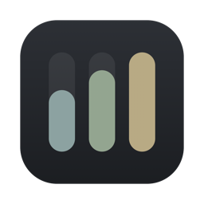

#  NabBar

[](https://github.com/M-Nabeegh/NabBar/actions/workflows/ci.yml)

A macOS menu bar app that shows how much of your Codex, Claude and Command Code usage is left.


It is a trimmed-down build of [ClaudeBar](https://github.com/tddworks/ClaudeBar) by TDDWorks.
ClaudeBar tracks 20 providers; NabBar tracks three, keeps its own settings, and can run next to an
installed ClaudeBar without touching it.

## What it shows

For each of Codex, Claude and Command Code:

- percent left in the current window, and when it resets
- the same numbers in the menu bar, coloured by how much is left
- weekly limits and model-specific limits where the provider reports them

It refreshes every 5 minutes, or when you click Refresh.

| Left | Colour |
|---|---|
| more than 50% | green |
| 20% to 50% | yellow |
| under 20% | red |
| 0% | dark red |

The colours can be changed in Settings → Appearance → Status Colors.

## Install

You need macOS 15 or later, Xcode, and [Tuist](https://tuist.dev) (`brew install tuist`).

```bash
git clone https://github.com/M-Nabeegh/NabBar.git
cd NabBar
scripts/build-local.sh --install
```

This builds the app, signs it ad hoc, checks the signature, and copies it to
`/Applications/NabBar.app`. There are no prebuilt releases and no auto-update: to update, pull and
run the script again.

## Set up each provider

NabBar reads usage from the tools you already use. It never logs in for you.

**Claude.** Uses the `claude` CLI. It must be logged in and past its first-run screens:

```bash
claude auth login
claude    # pick a theme, then /exit
```

If the CLI is not logged in, NabBar shows "Authentication required".

**Codex.** Uses the Codex CLI. If you only have the copy inside the ChatGPT app, the install
script points NabBar at it. Click Refresh once after installing; until then NabBar won't run the
CLI in the background.

**Command Code.** Works once you are logged in to Command Code.

## Alerts

NabBar sends a macOS notification when a provider drops into yellow, red or empty. If you declined
the permission prompt, turn it on in System Settings → Notifications → NabBar.

## Touch Portal

The install script also writes `build/local/NabBar.tpp`. Import it in Touch Portal → Settings →
Plug-ins. It adds these states for `codex`, `claude` and `commandcode`
(prefix `com.nabeegh.nabbar.touchportal.state.<id>.`):

| State | Example |
|---|---|
| `left`, `used` | `80%`, `20%` |
| `reset` | `Resets in 2h 39m` |
| `summary` | `Claude` / `80% left` |
| `level` | `green`, `yellow`, `red` or `depleted` |
| `icon` | a meter image filled to the percent left, in the level's colour |

Common setups:

- Button text that follows the numbers: set the text to the `summary` state.
- Button colour that follows the level: add the event "NabBar: Claude level", choose a value,
  and change the button's background in that event.
- A live meter as the button icon: "Change icon from plugin state" with the `icon` state.
- A refresh button: the action "Refresh NabBar now".

## iPhone

NabBar can push your numbers to an iPhone through the third-party [Notify!](https://getnotifyapp.com)
app, as a Lock Screen Live Activity and widgets.

1. Install Notify! on the iPhone and open it once.
2. Copy the device ID and device token from Notify!.
3. In NabBar → Settings → Notify!, paste both, press Save Link, and turn on Publish to Notify!.
4. Press Send Now to check it arrives.

## What it reads and sends

Reads, never writes:

- **Claude:** the output of `claude /usage`; `~/.claude.json` for your account email and plan;
  Claude Code's session logs in `~/.claude/projects` for daily cost and token counts. If the CLI
  check fails, it falls back to Anthropic's usage API with the token in the
  "Claude Code-credentials" Keychain item.
- **Codex:** the output of the Codex CLI (`codex app-server`). An optional API mode in Settings
  reads `~/.codex/auth.json` instead.
- **Command Code:** the token in `~/.commandcode/auth.json`, sent to Command Code's own API.

NabBar never refreshes or rewrites any of those tokens. When one expires, it tells you to log in
again with that tool.

Writes:

- its own files in `~/.nabbar`: settings, `status.json` and usage history
- its log, `~/Library/Logs/NabBar/NabBar.log`, which never contains tokens or keys
- one key in `~/.claude.json`, marking its own working folder
  (`~/Library/Application Support/NabBar/Probe`) as trusted so the CLI runs there

Sends, only if you turn on Notify!: provider names, percentages and reset times, to
`push.getnotifyapp.com`.

It does not touch `~/.claudebar` or `/Applications/ClaudeBar.app`.

## Development

```bash
tuist install
tuist generate --no-open
xcodebuild test -workspace NabBar.xcworkspace -scheme NabBar-Workspace \
  -destination 'platform=macOS,arch=arm64' \
  -only-testing:ProvidersTests -only-testing:DomainTests -only-testing:DataSourcesTests \
  -only-testing:InfrastructureTests -only-testing:AppTests
```

CI runs the same tests on every push. Bedrock support needs the AWS SDK, which is left out; set
`TUIST_NABBAR_WITH_AWS=1` before `tuist install` to include it. The icon is drawn by
`swift scripts/local/draw-icon.swift out.png`.

## Credits

Built on [ClaudeBar](https://github.com/tddworks/ClaudeBar), © 2025 TDDWorks and contributors, MIT.
ClaudeBar's original README is in [docs/CLAUDEBAR_README.md](docs/CLAUDEBAR_README.md).
NabBar's changes are © 2026 M. Nabeegh, also MIT. See [LICENSE](LICENSE).
